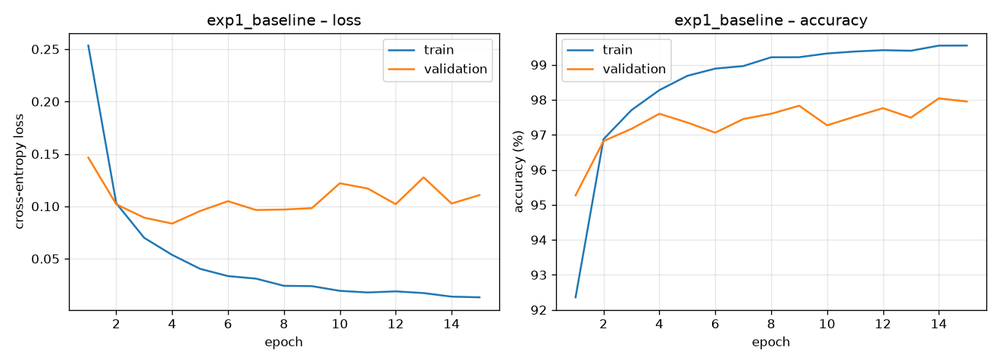
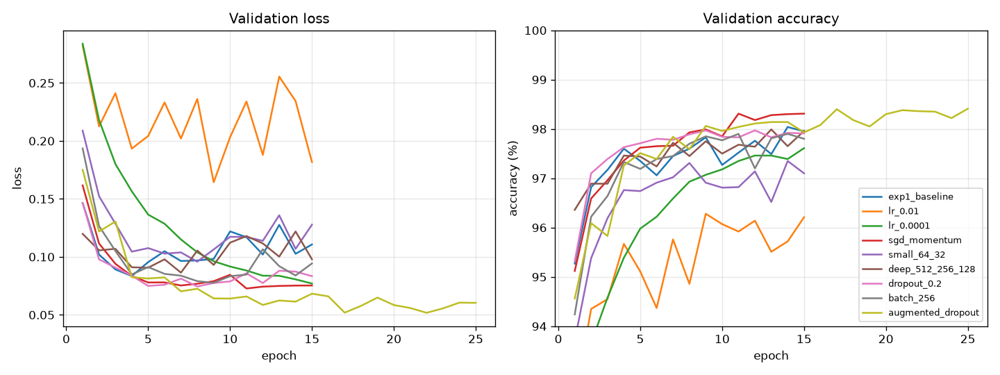
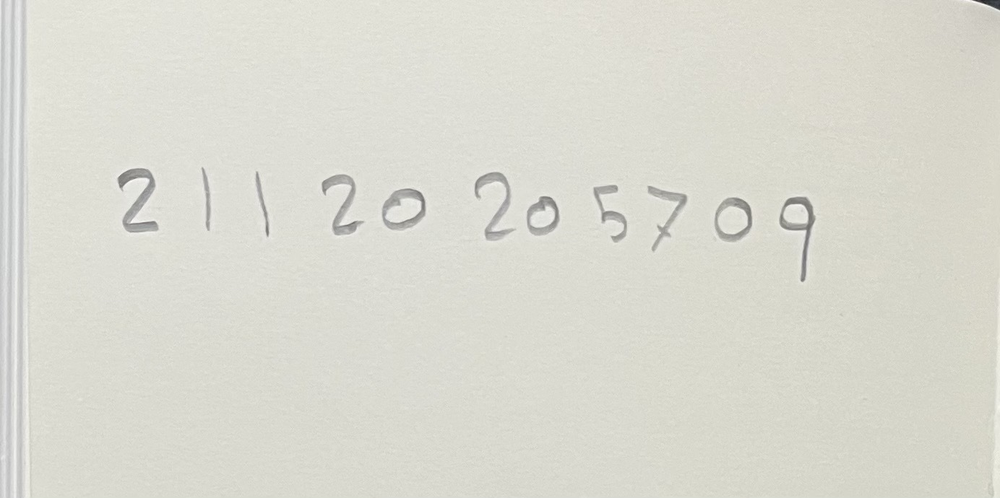
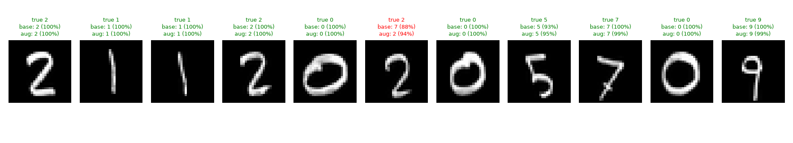

# Deep Learning – Homework 1: MLP-Based Handwritten Digit Recognition (MNIST)

**Student:** Farah Alhasan  
**Student Number:** 21120205709

A Multi-Layer Perceptron (no CNNs, no pre-trained weights, trained from scratch) built with **PyTorch**,
trained on MNIST, compared across several hyperparameter configurations, and finally tested on my own
handwritten student number.

## Project structure

```
mlp.py                   # data splits, MLP model, training + evaluation loops
train.py                 # runs Experiment 1 and the comparison experiments, makes plots
predict_handwriting.py   # preprocesses my handwriting to MNIST format and predicts it
handwriting/raw/         # photos of my handwritten student number
handwriting/processed/   # the same digits after preprocessing (28x28, MNIST style)
results/                 # metrics (json), training curves, comparison plots, summary tables
models/                  # trained weights for every configuration
```

## How to run

```bash
python3 -m venv .venv && source .venv/bin/activate
pip install -r requirements.txt

python train.py                 # downloads MNIST to data/, trains all configurations (~3 min on CPU)
python predict_handwriting.py   # runs the trained models on handwriting/raw/
```

`python train.py --only exp1_baseline` runs just Experiment 1.

## Dataset and the train / validation / test split

| Split | Size | Source | Used for |
|---|---|---|---|
| Train | 50,000 | official MNIST train set (random 50k, seed 42) | updating weights |
| Validation | 10,000 | official MNIST train set (remaining 10k) | monitoring each epoch, comparing configurations, choosing the best model |
| Test | 10,000 | official MNIST test set | **evaluated once, after all training and model selection had finished** |

The split is done in `load_mnist_splits()` in [mlp.py](mlp.py). The test set is never passed to `train()`;
in [train.py](train.py) all configurations are trained first, the best one is picked by validation accuracy,
and only then is the test set evaluated, for reporting only.

Preprocessing: pixels scaled to [0, 1], then standardized with the MNIST mean / std (0.1307 / 0.3081).
Each 28×28 image is flattened to a 784-dimensional vector inside the model.

## Experiment 1 – Basic MLP

| Hyperparameter | Value |
|---|---|
| Architecture | 784 → 256 → 128 → 10 (2 hidden layers) |
| Activation | ReLU |
| Loss | Cross-entropy (`nn.CrossEntropyLoss`, softmax included) |
| Optimizer | Adam, learning rate 0.001 |
| Batch size | 64 |
| Epochs | 15 |
| Dropout / augmentation | none |
| Weight init / seed | PyTorch default init, `torch.manual_seed(0)` |
| Parameters | 235,146 |
| Hardware | CPU (Apple Silicon laptop) |

**Results (after the final epoch):**

| Metric | Value |
|---|---|
| Training loss | 0.0131 |
| Validation loss | 0.1107 |
| Training accuracy | 99.55% |
| Validation accuracy | 97.95% |
| **Test accuracy** | **97.82%** |
| Training time | 12.9 s (15 epochs) |



The training loss keeps falling, but the validation loss is lowest around epoch 4 (0.084) and then
drifts upward and gets noisy while validation accuracy plateaus around 97.5–98%. So the model starts
**overfitting** after a few epochs: it keeps getting more confident on the training images without
generalizing better. The test accuracy (97.82%) is very close to the validation accuracy (97.95%), which
shows the validation set was a good stand-in for unseen data.

## Experiment 2 – Comparing configurations

Each run changes one thing relative to Experiment 1 (the last one combines the best ideas).
All numbers are from the final epoch. The best model by validation accuracy is in bold.

| Experiment | Hidden layers | Optimizer | LR | Batch | Dropout | Aug. | Epochs | Params | Train loss | Val loss | Train acc | Val acc | Test acc | Time (s) |
|---|---|---|---|---|---|---|---|---|---|---|---|---|---|---|
| exp1_baseline | 256-128 | adam | 0.001 | 64 | 0.0 | no | 15 | 235,146 | 0.0131 | 0.1107 | 99.55% | 97.95% | 97.82% | 12.9 |
| lr_0.01 | 256-128 | adam | 0.01 | 64 | 0.0 | no | 15 | 235,146 | 0.1129 | 0.1818 | 97.36% | 96.21% | 96.29% | 13.1 |
| lr_0.0001 | 256-128 | adam | 0.0001 | 64 | 0.0 | no | 15 | 235,146 | 0.0337 | 0.0770 | 99.14% | 97.61% | 97.63% | 13.4 |
| sgd_momentum | 256-128 | sgd (m=0.9) | 0.01 | 64 | 0.0 | no | 15 | 235,146 | 0.0010 | 0.0753 | 100.00% | 98.31% | 98.18% | 8.6 |
| small_64_32 | 64-32 | adam | 0.001 | 64 | 0.0 | no | 15 | 52,650 | 0.0210 | 0.1278 | 99.25% | 97.10% | 96.81% | 10.4 |
| deep_512_256_128 | 512-256-128 | adam | 0.001 | 64 | 0.0 | no | 15 | 567,434 | 0.0170 | 0.0979 | 99.46% | 97.96% | 98.05% | 22.0 |
| dropout_0.2 | 256-128 | adam | 0.001 | 64 | 0.2 | no | 15 | 235,146 | 0.0392 | 0.0834 | 98.77% | 97.91% | 98.10% | 13.6 |
| batch_256 | 256-128 | adam | 0.001 | 256 | 0.0 | no | 15 | 235,146 | 0.0061 | 0.0944 | 99.81% | 97.80% | 97.59% | 4.9 |
| **augmented_dropout** | 512-256-128 | adam | 0.001 | 64 | 0.2 | yes | 25 | 567,434 | 0.1430 | 0.0603 | 95.77% | 98.41% | 98.53% | 61.7 |

*Augmentation* = random rotation (±12°), shift (±12%) and zoom (0.85–1.15) applied to each training image
on the fly (`random_affine` in [mlp.py](mlp.py)). For runs with dropout or augmentation, training accuracy
is measured on the regularized / augmented batches, which is why it is lower than validation accuracy.



Training curves for every run are in [results/](results/) (`<name>_curves.png`).

### What changed and why

- **Learning rate.** `lr=0.01` with Adam is too large: the steps overshoot, the validation curve jumps
  around, and accuracy is the worst of all runs (96.2%). `lr=0.0001` is stable and overfits little
  (validation loss still falling at the end), but learns slowly and is still improving at epoch 15, so
  it would need more epochs. 0.001 is a good middle ground for Adam.
- **Optimizer.** SGD with momentum 0.9 (lr 0.01) gave the best plain result (98.31% val, 98.18% test)
  and was also the fastest per epoch. It reached 100% training accuracy, but its validation loss stayed
  flat instead of rising, so it overfit more gently than Adam with the same architecture.
- **Model size.** The small 64-32 network (4.5× fewer parameters) loses about 1% accuracy: it has less
  capacity. The deeper 512-256-128 network is only marginally better than the baseline and takes ~1.7×
  longer, so for MNIST the extra capacity mostly goes into memorizing the training set.
- **Dropout (0.2).** Lower training accuracy but higher test accuracy (98.10% vs 97.82%) and a much
  lower, steadier validation loss: dropout reduces overfitting.
- **Batch size.** Batch 256 is ~2.6× faster (fewer, larger steps) but generalizes slightly worse and
  overfits more (lowest training loss, higher validation loss). Small batches add useful gradient noise.
- **Augmentation + dropout + bigger network.** The best run. The training task becomes harder (95.8%
  training accuracy) but validation (98.41%) and test (98.53%) accuracy are the highest, and the
  validation loss is the lowest of all (0.060). The model learns to cope with shifted, rotated and
  differently sized digits, which matters most for real handwriting (see below). The cost is training
  time (25 epochs, 61.7 s).

## My handwritten student number

**Raw image:** [handwriting/raw/student_id.jpg](handwriting/raw/student_id.jpg) — my student number
21120205709 written by hand in pencil on paper and photographed with my phone.

**Preprocessing** (`predict_handwriting.py`), done to make the photos look like MNIST:

1. Convert to **grayscale**, light Gaussian blur to remove paper texture / noise.
2. **Invert colors** if the background is bright, so that the digit is white on a black background
   like MNIST; subtract the paper's background level and stretch the ink to full brightness; set faint
   pixels (shadows) to 0.
3. If the photo contains the whole number, **split it into digits**: find connected blobs of ink, ignore
   blobs touching the image border and tiny specks, merge blobs that overlap horizontally, sort left to right.
4. Crop each digit to its bounding box and **resize** so the longest side is 20 px (keeping the aspect
   ratio), then paste it into a **28 × 28** canvas and shift it so its **centre of mass** is in the
   middle — the same way the original MNIST digits were made.
5. Scale to [0, 1] and **normalize** with the MNIST mean / std.

The processed 28 × 28 digits are saved in [handwriting/processed/](handwriting/processed/).

**Results:**



The photo was split automatically into 11 digits (connected ink blobs; blobs touching the image border,
such as the page edge on the left and the table in the top-right corner, are ignored). After
preprocessing, and the predictions of Experiment 1 vs. the best model:



| Position | 1 | 2 | 3 | 4 | 5 | 6 | 7 | 8 | 9 | 10 | 11 | Correct |
|---|---|---|---|---|---|---|---|---|---|---|---|---|
| True | 2 | 1 | 1 | 2 | 0 | 2 | 0 | 5 | 7 | 0 | 9 | |
| exp1_baseline | 2 | 1 | 1 | 2 | 0 | **7** | 0 | 5 | 7 | 0 | 9 | 10/11 (90.9%) |
| augmented_dropout | 2 | 1 | 1 | 2 | 0 | 2 | 0 | 5 | 7 | 0 | 9 | **11/11 (100%)** |

All trained models on the same 11 digits ([results/handwriting_all_models.txt](results/handwriting_all_models.txt)):

| Model | MNIST test acc | Predicted | My handwriting |
|---|---|---|---|
| exp1_baseline | 97.82% | 21120**7**05709 | 10/11 |
| lr_0.01 | 96.29% | 21120**7**05709 | 10/11 |
| lr_0.0001 | 97.63% | 21120**7**0**3**709 | 9/11 |
| sgd_momentum | 98.18% | 21120**7**0**3**709 | 9/11 |
| small_64_32 | 96.81% | 2112020**8**709 | 10/11 |
| deep_512_256_128 | 98.05% | 21120**7**0**3**709 | 9/11 |
| dropout_0.2 | 98.10% | 21120**9**0**3**709 | 9/11 |
| batch_256 | 97.59% | 2112020**3**709 | 10/11 |
| **augmented_dropout** | **98.53%** | 21120205709 | **11/11** |

The two hard digits are the second **2** (position 6) and the **5** (position 8). My second 2 is narrow
and tall with a small curl, so after resizing to 20 px its top-right hook and diagonal look like a 7.
My 5 has a straight, separate top stroke and an open bottom curve, which models confuse with a 3 or 8.
The digits are also written in pencil, so the strokes are thinner and fainter than the felt-tip
strokes in MNIST.

## General evaluation and discussion

- **The MLP learns MNIST well.** Even a basic 2-hidden-layer MLP reaches ~97.8% test accuracy in about
  13 seconds of CPU training; the best configuration reaches 98.5%.
- **Overfitting is the main problem, not capacity.** Training accuracy gets close to 100% in every plain
  run while validation loss rises after a few epochs. The changes that helped most were the ones that
  regularize — dropout, augmentation, and SGD with momentum — rather than simply adding more neurons.
- **Hyperparameters matter.** The learning rate had the largest effect: 10× too large cost almost 2% of
  accuracy and made training unstable; 10× too small made it slow. Batch size traded speed for a bit of
  accuracy.
- **Validation vs. test.** Validation and test accuracy are within ~0.3% for every configuration, so
  choosing the model on the validation set (without looking at the test set) gave an honest estimate of
  performance on unseen MNIST data.
- **Distribution shift.** MNIST digits are clean, centred and written with similar pens. My photos
  differ in stroke thickness, lighting, paper texture, slant and how the digits are drawn (e.g. a 1 with
  or without a base, a 7 with a cross-bar). An MLP treats every pixel position as a separate input — it
  has no built-in idea that a shifted digit is the same digit — so it is sensitive to these differences.
  Careful preprocessing (centring by centre of mass, 20 px box, same colours and normalization) removes
  a lot of the shift, and training with augmentation made the model more robust to what is left.
- **MNIST accuracy does not guarantee real-world accuracy.** SGD with momentum was the best plain model on
  the MNIST test set (98.18%) but read only 9 of my 11 digits, while the small 64-32 network (96.81% on
  MNIST) read 10. Differences of a few tenths of a percent on MNIST say little about how a model handles
  data from a different distribution. The only model that read my whole student number correctly was
  the one trained with augmentation, because it had seen digits that were shifted, rotated, thinner or
  thicker during training. With only 11 digits this is a small sample, but it is the expected effect:
  the test set measures generalization *within* MNIST, while my handwriting measures generalization
  under distribution shift.
